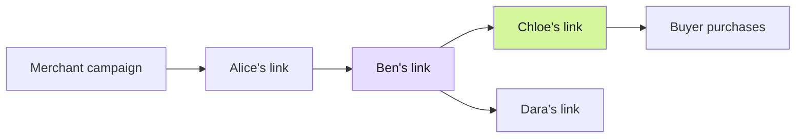

A Spoke link is a node in a campaign's distribution graph. The node records its owner and parent. If someone creates a link from yours, their node becomes your child. That parent relationship is fixed when the node is created.

The graph records how distribution spreads. A sale's paid path is the bounded set of eligible ancestors selected from that graph under the campaign's policy.

In this illustrative graph, a purchase through Chloe's link starts with Chloe as the nearest contributor, then Ben, then Alice. Dara is on a different branch and is not part of that sale's paid path.

## A growing network, a bounded reward

A campaign supports **one to five rewarded levels**. The graph may have more ancestry than the policy pays. Being visible in a graph does not make every ancestor eligible for every sale.

The create-link preview explains the current policy, the expected path, and how a short path affects the split. Always read that preview before creating your link.

## Direct purchases

A buyer can purchase directly without a distributor node. The contract represents this with `nodeId = 0`. A direct sale reserves **no distributor commission**, even when the campaign has a reward policy.

## Reading the network view

<Frame caption="The live campaign network separates the settled and refunded testnet sales.">
  
</Frame>

Use the graph to inspect ancestry and branches. Use the table for a compact list, or the path view to focus on attribution. Selecting a sale connects a commercial event to the exact path it used.

Privacy settings can replace an account's public identity with **Someone**. A private profile does not erase public blockchain transactions or alter who the contract pays.

## What cannot create a reward

Clicks, link creation, sign-ups, and additional sharers are not commission events. A qualifying purchase must reserve a reward and complete settlement before the recipient can claim it. See [settlement](/concepts/settlement).
