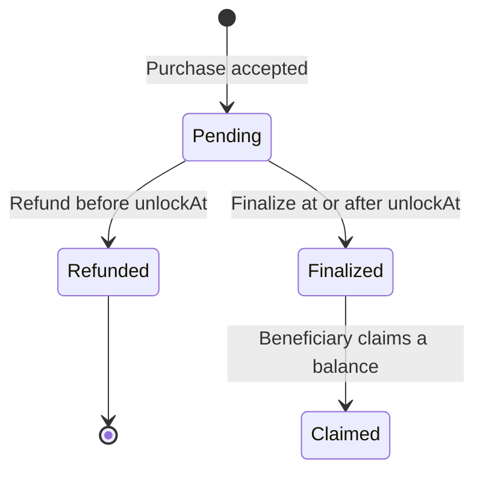

Spoke separates a successful purchase from a withdrawable reward. The contract reserves the allocation during the hold and makes it claimable only after finalization.

`Claimed` in this diagram describes beneficiary balances. Different recipients can claim at different times; it is not a second sale settlement state.

## 1. Purchase and reservation

Checkout records a client-generated order key, product version, policy version, attribution node, buyer payment, and eligible allocations. The merchant's reward budget reserves the required reward. The buyer's payment is held separately.

Repeated requests should use the same order key for the same logical purchase. A new order key represents a new purchase, not a safe retry.

## 2. Refund or finalize

A pending sale can be refunded **strictly before** its `unlockAt` timestamp. The refund returns the buyer payment and releases the reserved reward. Buyer delivery access is revoked for the refunded sale.

At or after `unlockAt`, the sale can be finalized. Finalization turns reserved rewards into distributor claimable balances and makes merchant proceeds claimable. A refunded sale cannot later finalize, and a finalized sale cannot use the pending-sale refund path.

Opening a refund request is not itself an onchain refund. Inspect the sale's receipt for the final result.

## 3. Claim

Each beneficiary withdraws their own claimable balance. Seeing **Claimable** is different from having completed a claim transaction. Wait for the transaction receipt and refreshed balance before treating funds as withdrawn.

## The six earnings buckets

| API bucket        | How to read it                                                                                                                               |
| ----------------- | -------------------------------------------------------------------------------------------------------------------------------------------- |
| `atRisk`          | Reserved rewards on pending sales still inside the hold                                                                                      |
| `readyToFinalize` | Pending rewards whose hold has elapsed, awaiting finalization                                                                                |
| `claimable`       | Finalized rewards available for a claim                                                                                                      |
| `claimed`         | Rewards already withdrawn through a claim                                                                                                    |
| `refunded`        | Rewards released because the underlying sale was refunded                                                                                    |
| `reversed`        | Reserved for reversed allocations; currently remains zero in live earnings. The contract does not expose a post-finalization reversal action |

Do not add all six buckets together and call the result earnings available to withdraw. Refunded or reversed history does not belong in a claimable total.

## Pausing and ending campaigns

Pause, end, and expiry stop new links and purchases. Existing refund, finalization, and claim obligations continue.

A merchant can withdraw unused rewards only while the campaign is paused, ended, or expired. The contract preserves reserved and claimable obligations. Pausing is not a way to take back someone else's finalized reward.

## Reading transaction progress

The client distinguishes `not_submitted`, `wallet_confirmation`, `submitted`, `included`, `confirmed`, `indexed`, and `done`. It also handles `rejected`, `unknown`, `replaced`, and `failed`.

An `unknown` result is not proof that a transaction failed. Inspect its hash and current chain state before retrying; see [troubleshooting](/guides/troubleshooting).
