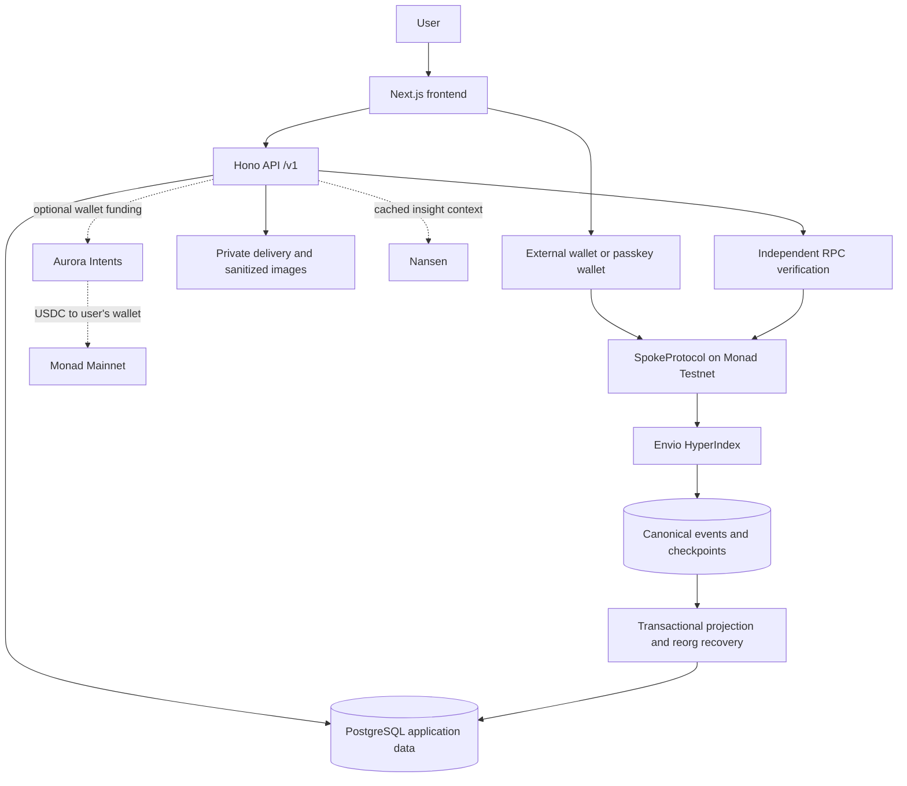
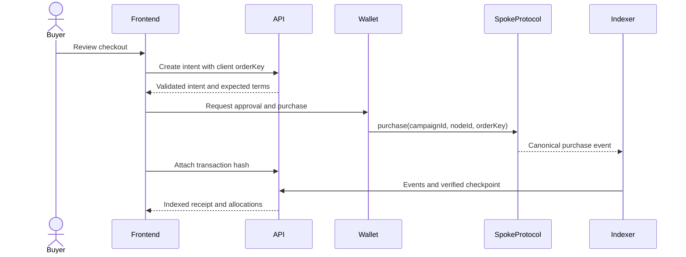

Spoke separates settlement, indexed reads, account services, and user interaction. The contract is the authority for money. The API provides validated access to derived views and offchain records; it cannot invent settlement outcomes.



The dotted paths are separate integrations. Neither Nansen context nor Aurora funding determines testnet reward allocation.

## Components and responsibilities

| Layer                   | Implementation                                              | Owns                                                                                           |
| ----------------------- | ----------------------------------------------------------- | ---------------------------------------------------------------------------------------------- |
| Web application         | Next.js, React, TypeScript                                  | Navigation, wallet interaction, previews, account and settlement UI                            |
| Shared protocol package | TypeScript and Zod                                          | Client method inputs/outputs, routes, statuses, errors, API envelopes                          |
| API                     | Hono on Node.js                                             | Authentication, validation, product metadata, checkout intents, delivery access, read services |
| Settlement              | Solidity and Foundry                                        | Campaigns, policies, immutable parent links, purchases, refunds, liabilities, claims           |
| Event ingestion         | Envio HyperIndex                                            | Chain events, checkpoints, historical sync, realtime ingestion                                 |
| Projection              | API-side canonical verification and PostgreSQL transactions | Read-model updates, cursor consistency, reorg recovery                                         |
| Storage                 | PostgreSQL and private file storage                         | Application records, indexed views, products, delivery assets                                  |
| Public SDK              | Workspace TypeScript package                                | Validated public read calls with typed errors                                                  |

## A purchase across the stack



A wallet signature, a transaction inclusion, and an indexed receipt are separate states. The UI tracks them rather than treating a successful HTTP request as an onchain sale.

## Trust boundaries

**Money:** buyer payments and merchant-funded rewards stay separate in the contract. Claims are pulled by beneficiaries. Public receipts expose the settlement evidence.

**Identity:** wallet-bound sessions protect account routes. State-changing API calls require the allowed origin and CSRF protections. Sensitive account actions require fresh confirmation.

**Files:** public images are sanitized and re-encoded. Private product assets require ownership or buyer entitlement; delivery access rechecks sale state and refunds.

**Read models:** the API verifies canonical block hashes independently before projecting events. A stale read cannot redefine a contract balance.

**Provider data:** Nansen insight context is cached and labeled. It does not produce a trust score or affect payout amounts. Aurora status requires destination-chain verification before funding confirmation.

## Repository map

```text
apps/web/             Application and wallet-facing client
apps/api/             Hono routes, services, authentication, projection
packages/protocol/    Shared schemas, routes, errors, and statuses
packages/contracts/   Solidity, tests, ABIs, and deployment evidence
packages/sdk/         Typed public read client
indexer/              Envio configuration and event ingestion
```

The public source is [Enoch208/spoke](https://github.com/Enoch208/spoke). This documentation lives separately in [Enoch208/docs-madonna](https://github.com/Enoch208/docs-madonna) and is published through Mintlify.
