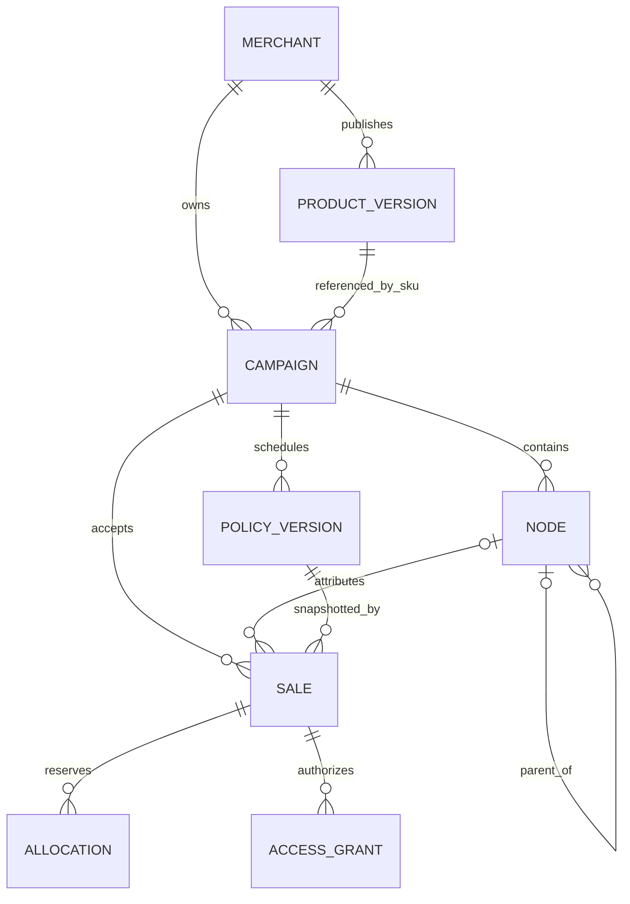

The onchain model defines settlement. The application database adds identities, product content, sessions, checkout tracking, and query-friendly projections. Similar-looking fields in these layers have different authority.

A direct purchase has no distributor node. A sale's policy version and allocations are accepted snapshots, not joins to whichever policy happens to be current later.

## Identifier conventions

| Identifier                               | Representation                                | Scope                                         |
| ---------------------------------------- | --------------------------------------------- | --------------------------------------------- |
| Campaign, node, sale                     | Unsigned decimal strings in live API JSON     | Contract deployment and chain                 |
| Chain ID                                 | Integer                                       | Network                                       |
| Wallet/contract                          | 20-byte hexadecimal address                   | Interpret with chain context                  |
| Order key, policy hash, transaction hash | 32-byte hexadecimal value                     | Different semantic roles despite equal length |
| Application record ID                    | Validated resource ID                         | Account/catalog/intent service                |
| Demo ID                                  | `demo-…` where supported by the shared client | Fixture environment only                      |

Shared frontend schemas sometimes admit both live and Demo identifiers. The live service still requires its onchain ID shape. A Demo ID in a structural JSON schema is not evidence that the live contract accepts it.

## Contract records

A campaign records the merchant, token, metadata hash, SKU hash and price, lifecycle flags, schedule, and counters. A policy version records its full terms, hash, version number, and effective time. A node records campaign, parent, owner, metadata hash, and creation time.

A sale records buyer, campaign, node, order key, accepted policy version/hash, price, reserved reward, purchase/unlock times, status, and source. Allocations record recipient, amount, depth, and effective weight.

The source enum includes future categories, but the currently implemented checkout is native onchain. Do not interpret an enum member as an implemented external attestation integration.

## Application storage

| Table family        | Purpose                                                                      | Rebuild from chain alone?                                |
| ------------------- | ---------------------------------------------------------------------------- | -------------------------------------------------------- |
| `api_records`       | Typed records including accounts, products, intents, grants, and projections | Only its chain-derived record kinds                      |
| `api_identities`    | Unique identity/handle/wallet ownership mappings                             | No                                                       |
| `api_challenges`    | Short-lived authentication challenges                                        | No; can expire rather than be restored as valid sessions |
| `api_sessions`      | Hashed session and CSRF credentials, account linkage, expiry                 | No                                                       |
| `api_confirmations` | Single-use action-bound confirmations                                        | No                                                       |
| `api_idempotency`   | Owner/key/fingerprint-to-record mapping                                      | No; important for safe request recovery                  |
| `api_rate_buckets`  | Durable rate-limit counters                                                  | Operational data                                         |
| `api_chain_events`  | Events with chain, hash, log, block, and timestamp identity                  | Yes, from the canonical deployment history               |
| Envio schema        | Worker entities and checkpoints                                              | Yes, with a deliberate replay                            |
| Private asset files | Product files and sanitized images                                           | No; database replay cannot recreate bytes                |

## Event identity and consistency

The event identity includes chain ID, transaction hash, log index, and block hash. Including the block hash lets the system distinguish canonical placement during a reorganization. A transaction hash alone is not a complete event identity.

Projection and cursor advancement commit together. Readers that need exact reconciliation should compare a consistent indexed block and its canonical hash. If the cursor changes while an earnings snapshot is read, the API can return `INDEXER_LAGGING` and require a retry instead of presenting inconsistent sums.

## Backup implications

A chain replay can reconstruct settlement history, but cannot reconstruct private product files, profiles, support content, account ownership records, or original idempotency context. Back up application storage and file storage together, then exercise restore in isolation. See [operations and recovery](/developers/operations).
