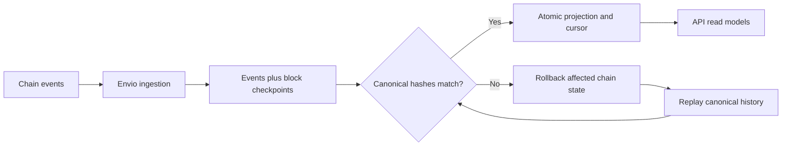

## Events become application views

Production uses **Envio HyperIndex** to ingest contract events. Historical synchronization and realtime ingestion feed event and checkpoint records into PostgreSQL. Realtime ingestion uses a separate RPC path from the API's verification provider.

The API verifies event and checkpoint block hashes against its own RPC, then commits the projected views and cursor together in a database transaction protected by an advisory lock. This prevents concurrent projection from advancing an inconsistent cursor.

## Reorganizations and recovery

A chain reorganization can invalidate previously observed events. The projector reconciles against canonical blocks and replays the affected history. Offchain account data is separate from chain-derived projections and is preserved through recovery.

Do not infer final account balances by counting events in a browser. Use the validated views and contract-backed verification endpoints where appropriate.

## Measure freshness

[GET /v1/system/status](https://api.usespoke.xyz/v1/system/status) exposes actual index progress. Envelopes can also include a block number and `indexingStatus` of `live`, `syncing`, or `behind`.

The current freshness threshold marks views behind when indexed time lags by more than 15 seconds. This is a diagnostic threshold, not a guaranteed service-level agreement. Provider outages, catch-up, or reorg recovery can increase lag.

For a transaction, wait for the relevant event to be indexed. A fresh global cursor alone does not replace checking that transaction's receipt.

## Local indexing

Local development can use direct RPC log ingestion against Anvil. Production uses Envio with independent verification. Both paths must respect canonical block boundaries and keep a consistent projection cursor.

See the [indexer source and runbook](https://github.com/Enoch208/spoke/tree/main/indexer) for configuration and replay procedures.

## Nansen insight context

The application includes a Nansen-backed insight integration with cached supported-mainnet history for demonstration wallets. The current seeded wallet results report no observed history. That is an absence of observed provider data, not a claim about a person's identity or quality.

External history is not Monad Testnet revenue, a reputation guarantee, a trust score, or a payout input. Refreshes are explicitly budgeted; ordinary page views do not trigger uncontrolled provider queries.

Keep three concepts separate: **onchain settlement evidence**, **the application's derived record**, and **external historical context**.
