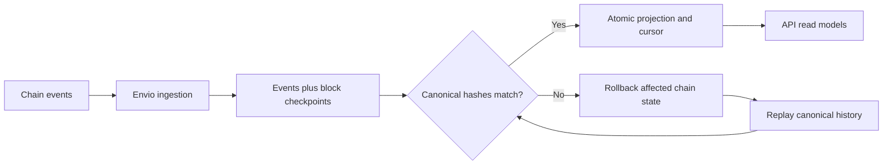

## Events become application views

Production uses **Envio HyperIndex** to ingest contract events. Historical synchronization and realtime ingestion feed event and checkpoint records into PostgreSQL. Realtime ingestion uses a separate RPC path from the API's verification provider.

The API verifies event and checkpoint block hashes against its own RPC, then commits the projected views and cursor together in a database transaction protected by an advisory lock. This prevents concurrent projection from advancing an inconsistent cursor.

## Reorganizations and recovery

A chain reorganization can invalidate previously observed events. The projector reconciles against canonical blocks and replays the affected history. Offchain account data is separate from chain-derived projections and is preserved through recovery.

Do not infer final account balances by counting events in a browser. Use the validated views and contract-backed verification endpoints where appropriate.

## Measure freshness

[GET /v1/system/status](https://api.usespoke.xyz/v1/system/status) exposes actual index progress. Envelopes can also include a block number and `indexingStatus` of `live`, `syncing`, or `behind`.

The current freshness threshold marks views behind when indexed time lags by more than 15 seconds. This is a diagnostic threshold, not a guaranteed service-level agreement. Provider outages, catch-up, or reorg recovery can increase lag.

For a transaction, wait for the relevant event to be indexed. A fresh global cursor alone does not replace checking that transaction's receipt.

## Local indexing

Local development can use direct RPC log ingestion against Anvil. Production uses Envio with independent verification. Both paths must respect canonical block boundaries and keep a consistent projection cursor.

See the [indexer source and runbook](https://github.com/Enoch208/spoke/tree/main/indexer) for configuration and replay procedures.

## Live product views

Partner Passport history is grouped by the UTC month of `SaleFinalized`; pending purchases and refunded sales never enter settled contribution totals. Each history point retains supporting receipt IDs. Campaign positions come from canonical `NodeCreated` records. Rewards use indexed liabilities and remain owner-only in Passport responses.

Network Activity deduplicates by canonical event identity, orders by block/log position, and paginates before resolving privacy-filtered actors. Its 30-day growth view includes an opening node balance for earlier history. Purchase, settlement and refund are different events and different counters. Activity refreshes every 15 seconds; graph snapshots and the owner's Passport refresh every 20 seconds while viewed. Expanded graph branches are reconciled with each new snapshot and removed if replay invalidates them.

The network shows indexed block/time and links events to public receipts and referral paths. These are derived views; the contract still owns financial entitlements. Tests cover canonical order, duplicate handling, restart, divergent history, stale graph branches, overlapping referral credit, refunds and balance reconciliation.

## Nansen insight context

[Partner Intelligence](/guides/partner-intelligence) adds explicit merchant research for public wallet addresses. It combines supported mainnet transaction history, first native-gas funding and Monad wallet relationships, with endpoint-level timestamps and transaction evidence. New Spoke wallets may have no history; external example wallets are not participating distributors.

External research is separate from native settlement evidence and cannot alter rewards or ranking. A page view reads the cache. An explicit refresh requires free-plan credits and durable budget checks; failures preserve uncertainty instead of inventing a risk score.
