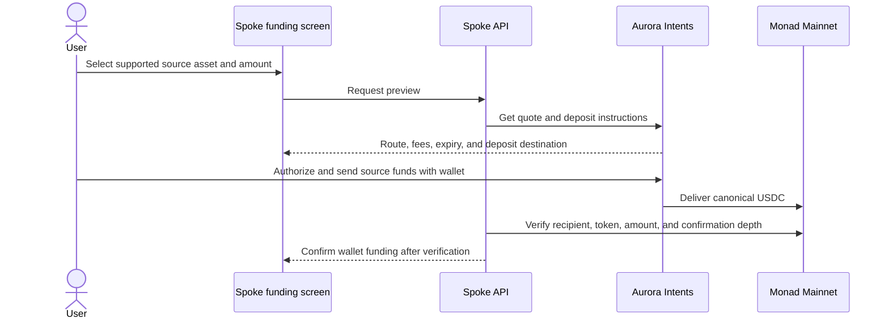

<Note>
  **Configured separately from commerce.** The hosted funding integration is
  enabled. Check the live configuration before starting a request. A user must
  review and execute any real source-chain transfer. This guide does not treat
  provider status or automated tests as proof of a new completed transfer.
</Note>

The funding flow lets a user move a supported source-chain asset into **canonical USDC on Monad Mainnet**, delivered to the authenticated external wallet. Aurora Intents provides routing and deposit instructions.

## How funding works

Spoke's API does not sign or broadcast the source transfer. The user executes it with their wallet. A provider status alone is insufficient for final confirmation: the destination receipt must match the expected token, recipient, amount, and required confirmation depth.

## Keep mainnet and testnet separate

- Destination network: **Monad Mainnet, chain 143**.
- Settlement application today: **Monad Testnet, chain 10143**.
- Mainnet USDC does not become SDUSD.
- Funding does not credit a campaign budget, buyer checkout, earnings balance, or reward vault.
- You still need mainnet MON to pay gas for later mainnet wallet transactions.

## Activation checklist

For a new deployment, complete provider configuration and confirm supported routes and canonical token settings. Verify a user-executed transfer from source deposit through canonical destination receipt before claiming that deployment has completed a transfer. Test expiry, underpayment, delayed delivery, refund, and retry behavior as supported by the provider.

The current public configuration is available at [GET /funding/aurora](https://api.usespoke.xyz/v1/funding/aurora). The API also defines authenticated preview, create-deposit, and own-deposit-status routes. See [API reference](/developers/api).
