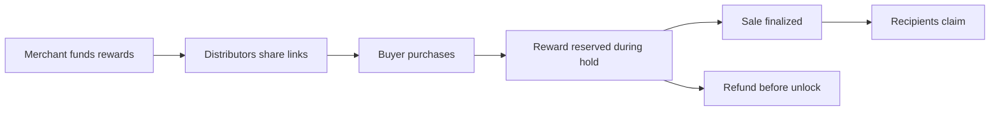

**Distribution is a network. Now everyone in it can earn.**

Spoke connects merchants, distributors, and buyers through a shared distribution graph. Merchants publish products and fund a reward budget. Distributors create links, other people can build on those links, and a qualifying sale rewards the eligible people on its path under the merchant's published policy.

The sale, allocation, refund, and claim each leave a verifiable record. A recommendation only produces a reward when it leads to a qualifying purchase; creating a link or recruiting another sharer does not itself pay anything.

<Note>
  Spoke's settlement application currently runs on **Monad Testnet**. SDUSD is a
  freely mintable demonstration token with no cash value. The hosted application
  is deployed; mainnet commerce is not yet live.
</Note>

<Frame caption="The deployed Explore experience. These campaigns use testnet demonstration tokens, not customer revenue.">
  
</Frame>

## Choose your starting point

<Columns cols={2}>
  <Card title="Try Spoke in five minutes" icon="bolt" href="/quickstart">
    Explore a campaign, inspect a real testnet receipt, and follow the
    distribution path.
  </Card>
  <Card title="Sell through a network" icon="store" href="/guides/merchants">
    Create a product, fund a campaign, and manage settlement.
  </Card>
  <Card title="Share and earn" icon="link" href="/guides/distributors">
    Understand your link, your eligible rewards, and when you can claim.
  </Card>
  <Card title="Build on Spoke" icon="code" href="/developers/architecture">
    Explore the contracts, typed API, indexer, and public read SDK.
  </Card>
</Columns>

## The complete loop

1. **Publish an offer.** A merchant attaches a product and commission policy to a campaign.
2. **Build a path.** Each distributor's link records a fixed parent. Branches remain visible in the graph.
3. **Attribute a sale.** Checkout records the selected link, product version, policy, and eligible recipients.
4. **Settle fairly.** A refund releases the reward reservation. A finalized sale makes rewards and merchant proceeds claimable.
5. **Build a record.** Public receipts make outcomes inspectable; account visibility controls how people appear in public views.

## Why the reward budget matters

The merchant funds rewards separately from the buyer's payment. A sale cannot silently spend the buyer's payment as commission. Policy caps bound exposure, pending rewards stay reserved, and the merchant can withdraw only unused rewards when the campaign is paused or ended.

See [commission policies](/concepts/commission-policy) for the math and [settlement](/concepts/settlement) for the lifecycle.

## What is available today

The live testnet flow includes campaign discovery, merchant setup, products, funded campaigns, referral links, the graph, checkout, receipts, buyer delivery access, refunds, finalization, claims, and earnings views. Some additional screens are explicitly marked **Demo**. Partner Passports, live Network Activity, merchant-triggered Partner Intelligence and passkey-encrypted workspace sync are deployed. Aurora mainnet wallet funding is configured as a separate integration; it never funds testnet commerce.

Start with [current status](/project/status), review [public proof](/project/proof), or follow the [roadmap](/project/roadmap).

## Go deeper

The documentation now includes a [complete client method reference](/reference/overview), [exact reward examples](/concepts/economics-examples), [vault reconciliation](/concepts/vault-accounting), [checkout integration](/developers/checkout-integration), and [operations/recovery guidance](/developers/operations).

For day-to-day use, follow the [campaign launch checklist](/guides/campaign-launch), learn to [verify a receipt](/guides/reading-receipts), or find a direct answer in the [FAQ](/guides/faq).
